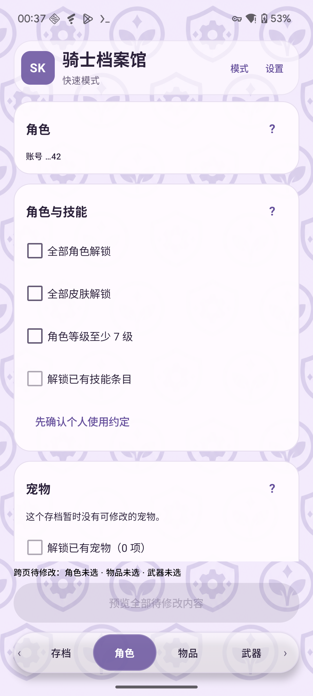
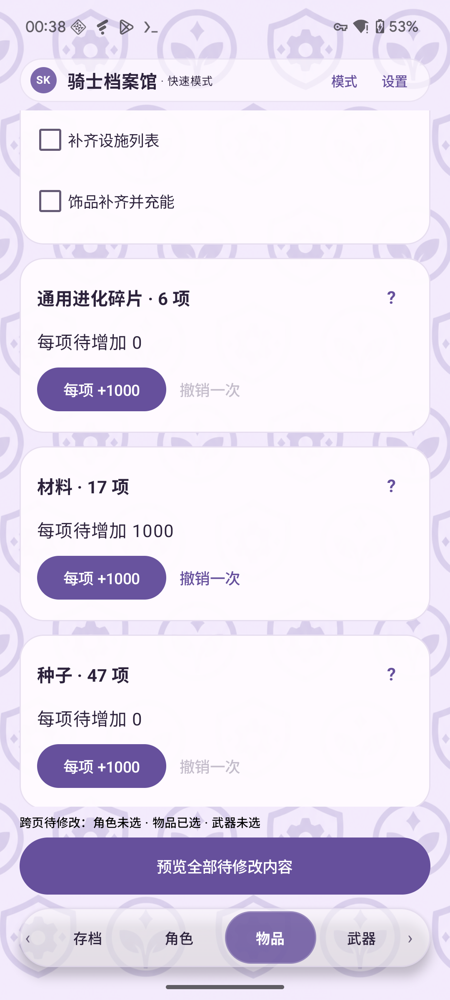
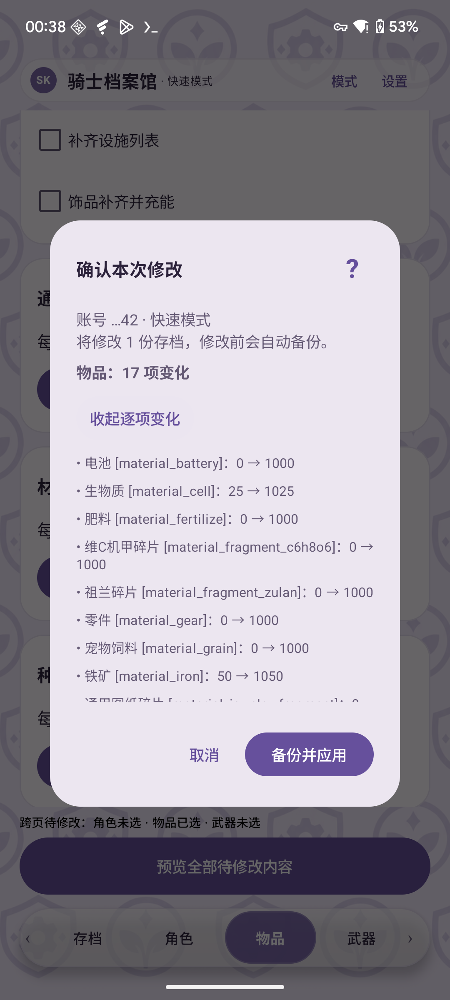

# 骑士档案馆 · 元气骑士本地存档工具

在自己的 Android 设备上读取元气骑士本地存档，选择角色、皮肤、物品或武器获取次数的修改，先看预览，再备份并应用。提供批量操作的**快速模式**，也提供按名称搜索、逐项选择的**专家模式**，以及使用外部应用修改文件再导入的**自由编辑模式**。

**[下载 Android 2.0.4-rc01 APK](https://github.com/Show-o4210/Soul-Knight-Save-Editor/releases/download/v2.0.4-rc01/SoulKnightSaveEditor-2.0.4-rc01.apk)** · **[第一次使用：图文教学](docs/help/getting-started.md)** · **[帮助中心](docs/help/README.md)**

[加入我们 · QQ 群聊](https://qm.qq.com/q/9Sg9mdgarY)：也可点击应用标题卡片旁带群组图标的“加入我们”按钮，通过 QQ 或浏览器打开邀请链接。

当前正式发布 **`2.0.4-rc01` / versionCode 25**，沿用维护者已测试的签名 APK。新增[游戏版本列表](docs/help/game-versions.md)，统一自由编辑黑灰配色，并加入 [8.7.0 适配](docs/compatibility-8.7.0.md)，保留 8.6.0 支持、修复“鱼干之王”、补齐三把遗漏武器。现在还支持[武器皮肤解锁与当前皮肤选择](docs/weapon-skins-8.7.0.md)：8.7 核对 184 个皮肤，8.6 核对 176 个；批量解锁保留当前选择，专家模式可逐项换肤或明确选择最高品质。[发布说明与反馈要点](docs/releases/2.0.4-rc01.md)。

**最近实测：2026-10-22，维护者反馈模拟器测试通过；适配元气骑士 8.7.0。** 社区暂未提供独立复测反馈，其他设备与渠道继续收集问题。

**2.0.3 新增**：[自由编辑模式](docs/help/free-editing.md)可解码 `.data` 到自选目录，通过应用选择器使用外部工具编辑，再导入打包；多余文件先比较哈希，再按文件名前缀对应，冲突可选择或跳过。[备份](docs/help/backup-and-update.md)支持 ZIP 导入和原件还原、重命名，默认按“存档#0”递增且不限保留数量，可在设置限制数量并自动删除最旧备份。还原时对应账号已有的本地读取开关强制设为 0，即使原件为 1。

适用于 **Android 7.0 及以上、已 Root 的设备**。默认使用原生 Root，也可选择通过 Root 启动的 Shizuku。当前版本适配 **元气骑士 8.7.0**，保留 **8.6.0** 支持。其他版本、渠道与机型需要分别验证。

## 可以做什么

| 想做的事 | 操作例子 |
| --- | --- |
| 角色与皮肤解锁 | 快速模式选择全部现有角色／皮肤；专家模式只选自己需要的条目 |
| 等级、技能与宠物 | 将现有角色升到至少 7 级，保留更高等级；解锁存档中已有的技能、宠物条目 |
| 增加材料、种子等数量 | 在“材料”点一次“每项 +1000”：生物质 25 → 1025；专家模式可以只改生物质 |
| 调整小鱼干与试玩券 | 输入目标数量，例如小鱼干当前 5、输入 20，预览为 5 → 20；留空不改 |
| 磁带、蓝图、设施与饰品 | 磁带数量设为 1、蓝图研究、补齐设施、饰品补齐并充能 |
| 武器获取次数 | 快速模式全部 +8；专家模式搜索武器并单独增加次数。特殊武器的其他资格仍由游戏判断 |
| 武器皮肤 | 快速解锁目录内皮肤；专家模式逐项解锁、选择当前皮肤或明确选用最高品质 |
| 自由修改文件 | 解包到自选目录，自选外部打开方式，修改后导入、预览并重新打包；不校验字段含义，改坏存档由使用者承担 |
| 备份与还原 | 手动／自动备份、ZIP 导入、原件还原、重命名；默认不限数量，可设置上限自动删除最旧备份 |

  
  
  

截图中的账号、数值是演示数据，用来展示界面和操作方式。各项要求与限制见[功能说明](docs/help/features.md)；截图不代表这些修改已通过游戏内验证。

## 怎么开始

1. 下载上面的 **APK** 并安装。Release 提供已打包的安装文件，直接使用无需配置开发环境；“Source code”压缩包是源码。
2. 进入快速模式，在 Root 管理器中为助手授权；到“存档”页选择游戏版本，点“读取存档”。多个账号时，再选择目标账号。
3. 到“设置 → 备份与恢复”选择助手以外的文件夹，先“备份当前本地存档”。
4. 在角色／物品／武器页勾选或输入，点“预览全部待修改内容”，核对后再点“备份并应用”。
5. 查看操作结果，再进入游戏核对实际进度。读取、刷新和应用修改会关闭所选游戏，请先退出游戏。

不确定按钮作用时，从[图文教学](docs/help/getting-started.md)开始；[自由编辑图解](docs/help/getting-started.md#free-editing)配有当前虚拟机截图，说明导出、自选外部编辑器、导入冲突和最后的写回预览。找不到存档、按钮不可用或修改未生效时，看[常见问题](docs/help/troubleshooting.md)。旧 alpha／Debug 包与正式包签名不同，更新前先看[备份与安装更新](docs/help/backup-and-update.md)。

## 测试到什么程度

**2026-10-22，维护者反馈 2.0.4-rc01 在模拟器测试通过，游戏版本为 8.7.0。** 沿用该 APK 正式发布；该反馈未附逐项测试清单，不扩展为全部功能、设备或渠道均已验收。

核心改动已有 **232 / 232 项 JVM 检查通过**，包含 8.6、8.7 与群内样本的只读离线验证；Release 构建、lint 和正式签名验证通过。此前 Agent 在 Android 9 虚拟机检查原生 Root 读取、游戏列表切换和武器皮肤预览，未实际写回游戏。详细范围见[发布说明](docs/releases/2.0.4-rc01.md)。

**2.0.3 新功能的实际使用测试交由用户反馈。** 发布前已有 196 项 JVM 测试通过、5 项私有样本测试跳过；Debug 构建和 lint 通过，设备上 2 项应用选择器 Intent 检查通过。这些检查不包含外部编辑器实际保存、完整目录导出／导入操作或游戏加载效果。自由编辑只检查基础格式和打包，不修复字段、数值或分片关系；修改内容与游戏结果由使用者承担。

**历史 Root 双通道专项检查：2026-10-09。** Pixel 6 / Android 16 上的原生 Root 与 Shizuku Root 通道通过了合成文件读写、备份与事务恢复检查；该专项检查没有修改真实游戏存档。此前 vivo 8.6.0 有角色、皮肤解锁的用户实测反馈。最近模拟器实测日期为上述 2026-10-22。

模拟器实测通过不能代表全部功能、机型、Root 管理器、游戏版本或渠道兼容；OnePlus / APatch 等反馈环境仍待用户复测。详细范围见[验证记录](docs/root-shizuku-validation.md)和[开发状态](docs/development-status.md)。当前正式发布版本为 **2.0.4-rc01**，变更与验证边界见[发布说明](docs/releases/2.0.4-rc01.md)。

## 文档与反馈

| 你需要什么 | 入口 |
| --- | --- |
| 了解功能、按钮、备份与问题排查 | [用户帮助](docs/help/README.md) |
| `.data`、`.data.new`、本地读取开关与云存档同步 | [本地读取说明](docs/help/local-data-reading.md) |
| 构建、实现规则、测试与历史开发记录 | [开发文档](docs/development/README.md) |
| 使用原有 Python 桌面版 | [Python 说明](desktop/README.md)（功能与 Android 分别维护） |
| 查看版本或反馈问题 | [Releases](https://github.com/Show-o4210/Soul-Knight-Save-Editor/releases) · [Issues](https://github.com/Show-o4210/Soul-Knight-Save-Editor/issues) |

反馈时请说明助手版本、游戏版本／渠道、设备和 Root 方式、具体按钮及提示；存档与账号信息请勿公开上传。反馈示例见[常见问题](docs/help/troubleshooting.md)。

应用在本地运行，没有联网权限，不代替游戏登录或云存档功能。仅处理自己有权操作的文件。本项目与凉屋游戏无关，操作前请保留可恢复的原始存档。
