# 第一次使用：看图认识按钮

[帮助中心](README.md) · [功能说明](features.md) · [备份与更新](backup-and-update.md)

这篇介绍 Android 2.0.4-rc01 的快速／专家操作，以及[自由编辑的完整图解](#free-editing)。当前适配元气骑士 8.7.0，2026-10-22 维护者反馈模拟器测试通过。先准备已 Root 的 Android 设备、自己的本地存档和可保存备份的文件夹。配图中的数值来自独立演示文件，截图只说明界面。

## 1. 安装并选择模式

从[发布页](https://github.com/Show-o4210/Soul-Knight-Save-Editor/releases/tag/v2.0.4-rc01)下载 `SoulKnightSaveEditor-2.0.4-rc01.apk`，安装后打开“骑士档案馆”。首次弹出个人本地存档使用确认，阅读后按自己的意愿选择；尚未同意时写入和预览按钮不可用。

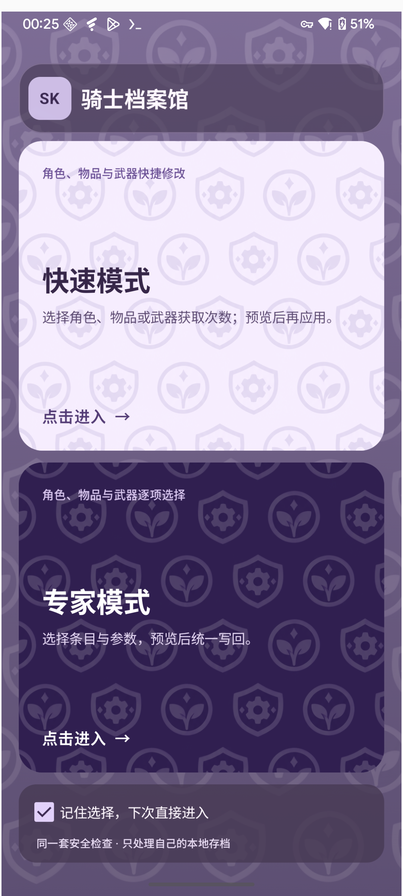

| 按钮／选项 | 有什么用 |
| --- | --- |
| 快速模式 | 按类别准备批量修改，适合先认识功能 |
| 专家模式 | 搜索名称或内部 ID，只选择需要的条目和数量 |
| 自由编辑 | 解码导出文件，自选外部应用修改，再导入打包；[向下看图解](#free-editing) |
| 记住选择，下次直接进入 | 下次打开跳过模式入口；仍可从页面上方“模式”切换 |
| 模式／设置 | “模式”回到上图；“设置”进入访问权限与备份入口 |
| 卡片右上角“？” | 查看当前功能说明和限制 |

上图保留旧版快速／专家入口；当前版本另有黑色的“自由编辑”卡片，见第 6 节。

## 2. 授权并读取存档

默认使用原生 Root。Root 管理器弹窗时为“骑士档案馆”授权；没看到弹窗，可以去管理器的超级用户列表检查。需要备选方式时，在“设置 → 存档访问方式”选择 Shizuku Root，另行安装 Shizuku、**通过 Root 启动**，再点“授权 Shizuku”与“检查／重试”。Shizuku 的 ADB 模式不能满足这里的私有存档访问要求。

  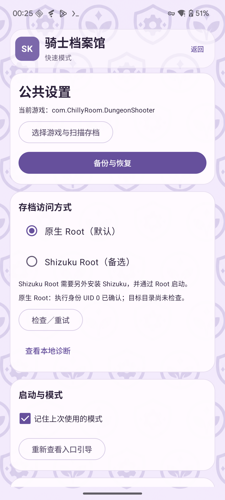
  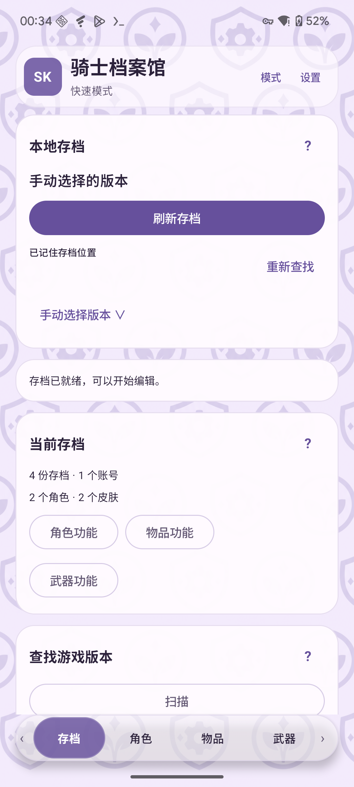

| 存档页按钮 | 有什么用 |
| --- | --- |
| 读取存档 | 读取已选游戏的本地文件；会关闭该游戏 |
| 刷新存档 | 已读取后，沿记住的位置重新读取最新内容；会关闭该游戏，并清空旧草稿 |
| 重新查找 | 重新寻找当前游戏的存档位置，找不到旧路径时使用 |
| 查找游戏版本 → 扫描 | 只读查找已安装游戏的存档特征，列出候选；这个查找按钮不会关闭游戏 |
| 选择这个版本 | 将候选设为目标，随后点“读取存档” |
| 手动选择版本 | 展开包名输入；确认实际渠道包名后点“使用这个版本”，再读取 |
| 账号选择 | 多账号时指定一个目标；只有一个账号时自动选中 |
| 角色功能／物品功能／武器功能 | 跳到对应页面，也可点底部标签切换 |

上图是**读取成功后**，主按钮已变成“刷新存档”。看到“存档已就绪”后再开始编辑；某类文件缺失时，其余能识别的功能可能仍可用。切换游戏、账号或访问方式后，要重新读取，旧草稿不会沿用。权限身份检查通过，也不代表已经找到游戏存档。

## 3. 先把原件保存到外部

进入“设置 → 备份与恢复”，点“选择文件夹”，在系统文件选择器中选一个自己能找到的位置，再点“备份当前本地存档”。“打开文件夹”用于查看导出的文件。

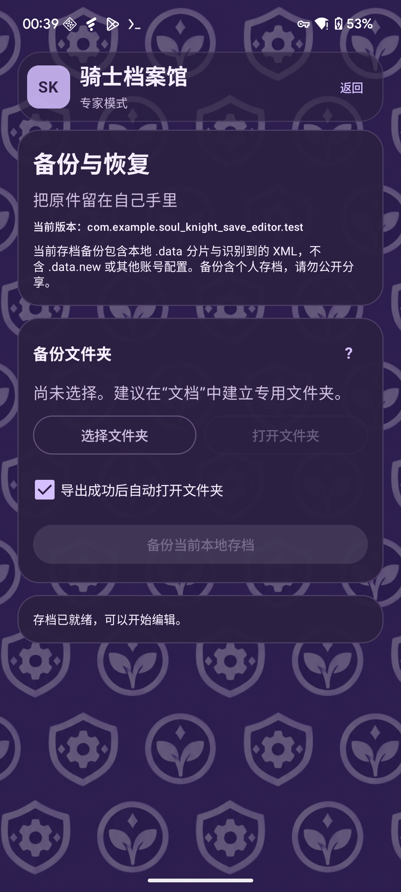

手动备份 ZIP 包含应用识别到的本地 `.data` 与 XML，**不包含 `.data.new`**。2.0.3 已支持 ZIP 导入、还原、重命名及保留上限；默认从“存档#0”递增且不限保留数量。两种备份和还原范围见[备份说明](backup-and-update.md)。

## 4. 准备修改：勾选和输入还没有写文件

  
  

快速模式中：

- **角色页**：勾选“全部角色解锁”“全部皮肤解锁”“角色等级至少 7 级”或“解锁已有技能条目”；宠物也在这一页。这里的“全部”受存档已有条目和适配范围限制，不会凭空补出全部角色、技能或宠物。示例没有宠物记录，所以宠物按钮不可用。
- **物品页**：磁带、蓝图、设施、饰品用勾选；材料、通用进化碎片、种子、兑换券各自有“每项 +1000”和“撤销一次”。点一次只增加这类草稿的 1000，再点一次是 2000。
- **小鱼干和试玩券**：向下滚动找到“目标数量（留空不改）”。输入 20 表示最终设为 20；输入 0 表示清零。
- **武器页**：“全部武器获取次数 +8”准备增加获取记录，其他锻造资格仍由游戏判断。

截图中的“材料 · 17 项”表示该分类范围；“每项待增加 1000”是待应用的增量。生物质原有 25，预览应为 1025，而不是 1000。取消勾选、清空输入或“撤销一次”都可以调整草稿。

### 只想改一项：专家模式

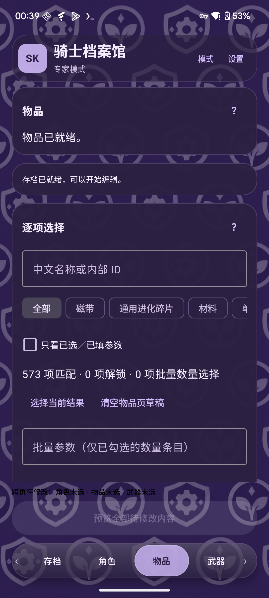

“中文名称或内部 ID”用来搜索；分类按钮缩小范围。“只看已选／已填参数”只过滤显示，不会自动取消其他草稿。“选择当前结果”批量选中当前筛选结果；数量条目还要填写参数，勾选本身不等于已经设置数量。

例如搜索“生物质”，在该项输入“增加量 100”：25 → 125；输入“目标数量 100”：25 → 100。批量操作时，先勾选“纳入批量数量操作”，填写“批量参数”，再点“设置目标数量”或“设置增加量”。同一项的目标和增量不能同时使用；“设置增加量”只对支持增量的数量条目开放。

“清空物品页草稿”清掉当前模式的物品修改；“撤销该项草稿”只清该项。快速与专家分别保留草稿，**当前模式**的草稿参与预览，另一套不会混入。

## 5. 看预览，再决定是否应用

底部“跨页待修改”提示哪些页面已有草稿。点“预览全部待修改内容”后，应用会重读最新存档，显示本次文件数和变化数；展开变化可核对原值与新值。预览重读也会关闭所选游戏。

| 按钮 | 有什么用 |
| --- | --- |
| 展开变化／收起逐项变化 | 查看或折叠具体条目与数值 |
| 取消 | 关闭预览，还可以回去调整草稿；不会应用修改 |
| 备份并应用 | **这一步才写入**：核对文件、备份原件、写回并复读检查 |

确认游戏版本、账号、条目和数值都符合预期再应用。结果窗口可以展开看成功项或失败原因；若提示有未完成事务，按恢复提示处理后再编辑。应用报告文件写入成功后，仍须进入游戏核对实际效果，不能把文件校验当成游戏内生效保证。

## 6. 自由编辑：导出 → 外部修改 → 导入 → 预览

自由编辑不内置文本编辑器。先按第 2、3 节确认 Root、游戏版本和外部备份，再从上方“模式”返回入口，向下滑动找到黑色的“自由编辑”卡片。进入后，底部主要是“存档”和“自由编辑”两页；需要换游戏时回“存档”页切换。

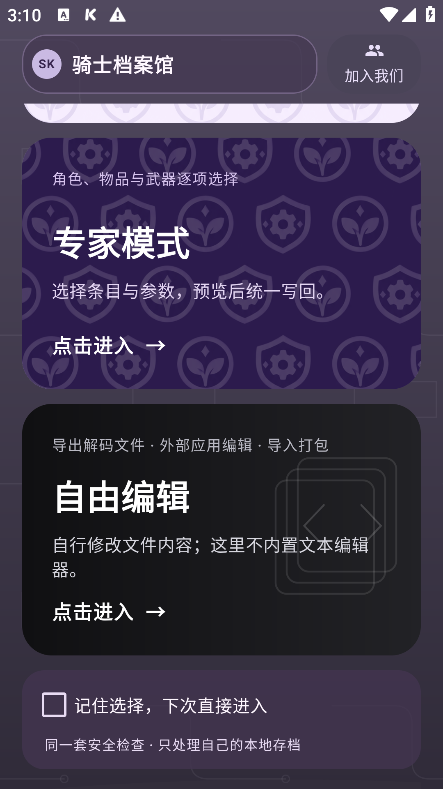

以下图片于 **2026-10-22** 从 **Android 9 虚拟机、正式签名 2.0.4-rc01** 通过 ADB 截取。`inventory.data`、`profile.data` 和 `opaque.data` 均为独立演示文件；字段与数值不是游戏修改教程。

**2.0.5-rc01 候选差异**：文件列表还会默认选中 `shared_prefs/` 中现有 XML，可以与 `.data` 一起导出，也可只选 XML；XML 保留原文及 `.xml` 后缀，导入后写回原 XML，相关账号已有读取开关仍设为 0。以下九张旧版截图不含新 XML 选项；新增范围见[候选说明](../releases/2.0.5-rc01.md)，操作规则见[自由编辑帮助](free-editing.md)。

### 6.1 读取文件，选目录，再解码导出

先点“读取文件”。向下滚动到“导出位置”，点“选择导出目录”（已有目录时显示“更换导出目录”），在系统文件选择器中进入自己能找到的本地文件夹并确认授权。本次示例选择下载目录里的 `SK-Free-Guide-20261022`。

  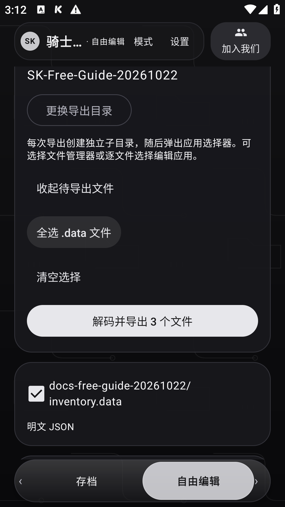
  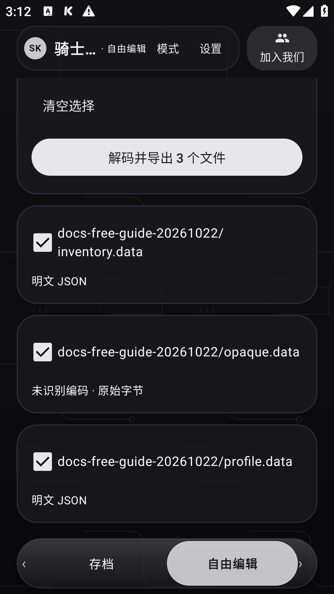

| 按钮／提示 | 怎么用 |
| --- | --- |
| 切换游戏版本 | 回到存档页，核对目标包名；切换后需要重新读取 |
| 读取文件 | 寻找所选游戏的 `.data`，不处理 `.data.new`；2.0.5 候选也读取 `shared_prefs/` XML；读取会关闭所选游戏 |
| 文件左侧勾选框 | 只导出自己要编辑的文件；勾选本身不写回游戏 |
| 全选 .data 文件／清空选择 | 旧图按钮；2.0.5 候选的全选包含 `.data` 与 XML，清空后可逐项选择 |
| 收起待导出文件／选择下一次导出文件 | 折叠或展开来源列表，不会清空选择 |
| 解码并导出 N 个文件 | 导出所选文件的编辑副本；按钮灰色时先检查目录授权和文件勾选 |

每次导出创建独立的“自由编辑-时间-编号”子目录，不覆盖上次工作目录。已识别的 JSON 导出为 `.json`；“未识别编码 · 原始字节”导出为 `.bin`，不是自动解码成功的 JSON，不要仅改后缀后当 JSON 编辑。

2.0.5 候选中的 XML 直接导出原文，例如 `003_com.example.game.v2.playerprefs.xml`；同样点“打开文件（选择应用）”交给外部编辑器。导入时认领原导出来源并写回原路径，外部文件名不能指定新的设备路径；只有旧导出记录时，重新读取并导出才能加入 XML。

### 6.2 自选外部应用，修改后先保存

导出后会请求通过应用选择器打开目录。也可回助手，在“外部编辑与导入”卡片点“打开目录（选择应用）”。如果目录打开不方便，点“逐文件打开（N 个）”展开列表，再点对应文件下方的“打开文件（选择应用）”。

  
  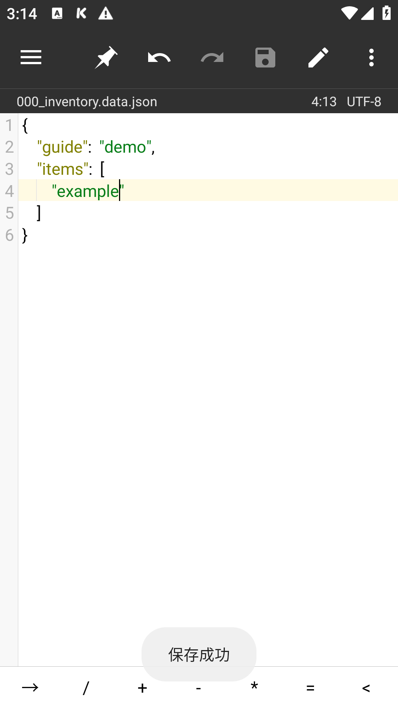

左图的应用列表由设备已安装的程序决定；只有一个兼容的目录处理程序时，系统也可能直接进入它。右图是本次虚拟机中已有的 **MT 外部文本编辑器**，不是助手内置界面，也不要求使用同一款应用。想修改内容，要选支持编辑并保存的应用；“文件预览”等选项可能只能查看。

本例仅将演示 JSON 的 `sample` 改成 `example`，点击外部编辑器顶部的“保存”，再切回骑士档案馆。尽量保留编号与原文件名前缀，例如 `000_inventory.data.json`，方便助手识别来源。**关闭编辑器或返回助手，不代表已经导入，更不代表已经写回。**

### 6.3 回到助手，手动导入修改后的副本

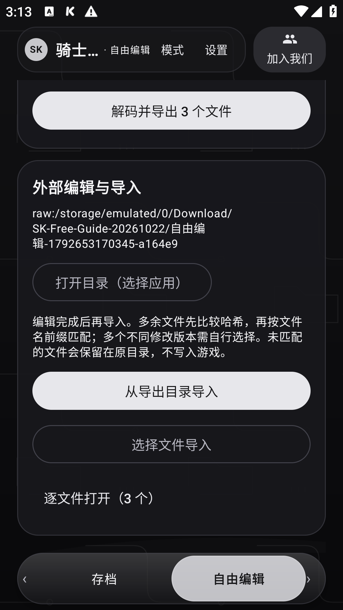

| 按钮 | 有什么用 |
| --- | --- |
| 打开目录（选择应用） | 再次打开本次导出的子目录，继续编辑或查看文件 |
| 逐文件打开（N 个） | 展开文件列表，为单个文件选择外部打开方式 |
| 从导出目录导入 | 重新比较本次导出子目录里的文件；原位置保存后优先用它 |
| 选择文件导入 | 从系统文件选择器选取文件，可一次多选；适合编辑器另存到其他位置的情况 |
| 继续上次导出 | 应用重启且保留原导出记录时，恢复到这次编辑；仍需手动导入最新内容 |

导入只做比较和准备预览。这一阶段不会把修改写入游戏；外部文件后来又改过，需要重新点导入，不能沿用旧比较结果。

### 6.4 看懂忽略文件，并处理多份修改版本

  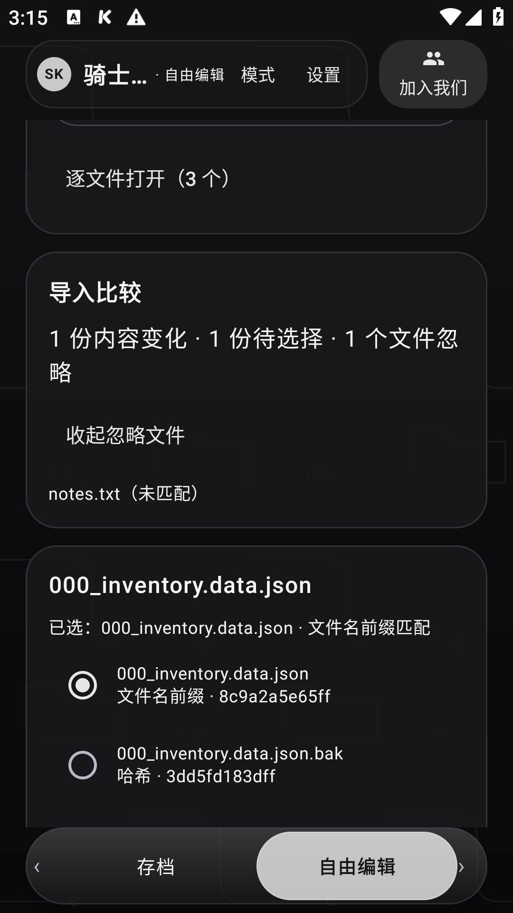
  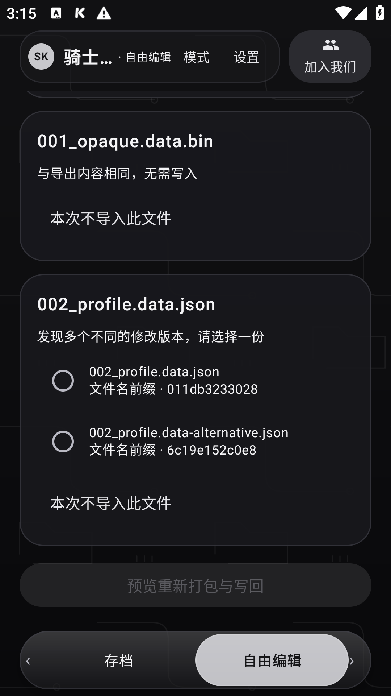

左图中，外部编辑器自动留下了 `000_inventory.data.json.bak`。它与原导出内容相同，被按哈希识别；修改后的 `.json` 按文件名前缀对应到同一来源。只有一份不同修改时，会优先选中该修改副本，不需要为了导入而删除 `.bak`。

另加的 `notes.txt` 没有匹配来源，显示“未匹配”。“查看忽略文件／收起忽略文件”用于查看原因；这些文件会留在外部目录，不写入游戏，也不会被助手删除。

右图的 `profile` 同时有两份不同修改，助手不会猜哪份正确。点击想使用的版本左侧单选圆圈，或点“本次不导入此文件”保留该来源的原存档。处理完所有“待选择”后，有实际内容变化才能预览。本例选择 `002_profile.data.json`，最终预览为两份变化；未修改的 `opaque.data.bin` 不写回。

### 6.5 核对文件对应关系，最后才应用

点“预览重新打包与写回”，再点“展开 N 项变化”。自由编辑的预览展示**导入文件 → 原存档文件、匹配方式和重新打包后的字节数**，不逐字段解释游戏数值。

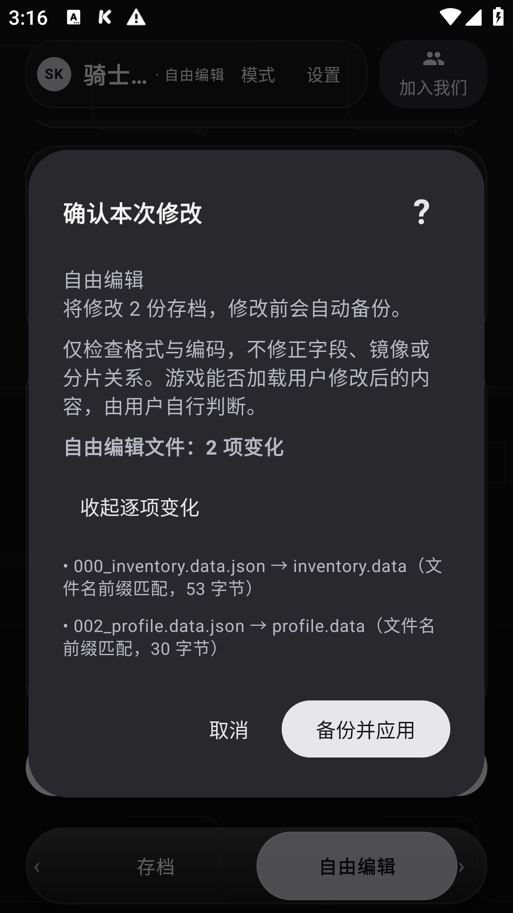

| 按钮／状态 | 下一步 |
| --- | --- |
| 取消 | 只关闭预览，回去重新选择副本或继续修改；没有应用写入 |
| 备份并应用 | **这一步才写入**：检查来源、备份当前原件、重新打包写回并复读校验 |
| 预览按钮灰色 | 检查是否还有“待选择”、没有实际变化、未确认个人使用约定，或有未完成事务 |
| JSON 格式错误 | 回外部编辑器修正并保存，再重新导入；格式通过不代表游戏字段有效 |
| 提示源文件已变化 | 游戏可能在导出后更新了存档；重新读取并导出，再核对自己的修改 |

写入完成后按结果提示处理，再重新读取、导出开始下一轮编辑。对应账号已有的本地读取开关会设为 0；自由编辑不替用户修复字段、数值或跨分片关系，游戏是否接受修改后的内容由用户自行判断。详细规则见[自由编辑说明](free-editing.md)。

本轮仅实际保存了外部的演示副本，并演示到预览后取消，**没有点击“备份并应用”**。四份演示来源及虚拟机中 34 份游戏 `.data`／XML 的前后哈希均不变；演示目录和本轮导出记录已清理，原游戏选择与设置已恢复。

第 1–5 节旧截图摄于 2026-10-10，来自同版功能的 `2.0.2-root01` 调试候选；第 6 节为 2026-10-22 的正式签名 `2.0.4-rc01` 自由编辑截图。[配图来源](../images/README.md)说明各组演示范围。**维护者最近模拟器实测日期为 2026-10-22，反馈通过，适配 8.7.0**，见[发布说明](../releases/2.0.4-rc01.md)；历史文件双通道专项检查为 2026-10-09，见[验证记录](../root-shizuku-validation.md)。遇到问题看[常见问题](troubleshooting.md)。
